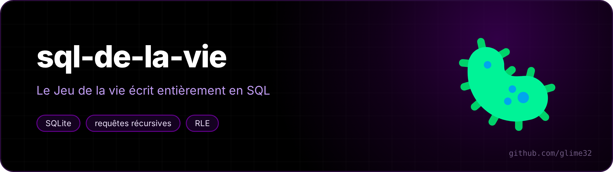

<p align="center"></p>

<p align="center"> </p>

Conway's **Game of Life**, and its whole family of "B/S" rules, written **entirely in SQL**. No loop, no variable, no imperative language: SQLite does everything, from reading the pattern to detecting cycles.

<p align="center"><a href="README.fr.md">🇫🇷 Version française</a></p>


*Gosper's glider gun, 240 generations computed by a single recursive query.*

## Run

```sh
./vie.sh canon -l 60 -H 34 -g 240     # animation in the terminal
./vie.sh --liste                      # the bundled patterns
./vie.sh diehard -b -g 140 -n         # only the summary
./vie.sh soupe -r B3678/S34678        # "Day & Night" on a random soup
./vie.sh -f motif.rle                 # any pattern from LifeWiki / Golly
./tests.sh                            # checks the engine against known results
```

You need `sqlite3` 3.44 or newer. `vie.sh` computes nothing: it creates the parameter table, hands the script to `sqlite3`, and shows the frames one by one. The program talks French (`bilan` = summary):

```
 ── bilan ──
 règle B3/S23 : une case naît avec 3 voisins, survit avec 2 ou 3
 grille 40×30 à bords morts, population 7 → 0 (max 40)
 tout est mort à la génération 130
 population ▂▂▃▃▅▄▅▆▄▄▄▅▄▅▃▃▄▅▆▆▇▅▅▇▅▇▆▅▃▃▃▂▃▄▃▅▅▆▅▇█▅▅▄▃▅▄▄▄▃▃▂▂▂▁▁▁▁▁▁
```

## How to do that in SQL

Everything is in [`vie.sql`](vie.sql), with comments (in French).

**The grid is a string.** A 40×24 grid becomes a 960-character text, `#` for a live cell, `.` for a dead one. Cell (x, y) is character `y·w + x + 1`.

**Neighbours are precomputed.** A table `voisins(i, j)` lists the 8 neighbours of each cell, wrapped around a torus or cut at the edges (`-b`). It comes from crossing the grid with two tiny tables `{-1, 0, 1}`.

**Each generation is one row of a recursive query.** The heart of the program:

```sql
WITH RECURSIVE g(n, s) AS (
  SELECT 0, (SELECT etat FROM depart)
  UNION ALL
  SELECT g.n + 1,
         (SELECT group_concat(
                   CASE WHEN instr(
                          CASE WHEN substr(g.s, c.i + 1, 1) = '#' THEN r.survie ELSE r.naissance END,
                          (SELECT sum(substr(g.s, v.j + 1, 1) = '#') FROM voisins v WHERE v.i = c.i)
                        ) > 0
                        THEN '#' ELSE '.' END,
                   '' ORDER BY c.i)
          FROM cases c, regle r)
  FROM g, param p WHERE g.n < p.gens
)
```

For each cell, count the `#` among its neighbours, then check whether that number appears in the list of birth digits (`'3'`) or survival digits (`'23'`): `instr('23', 3) > 0`. Changing the rule only means changing those two strings.

SQLite forbids aggregates (`group_concat`, `sum`) directly in the recursive part. The trick is to hide them in **correlated subqueries**: those are allowed and can see the previous generation `g.s`.

**RLE files are read by an automaton written in SQL.** A pattern like `bo$2bo$3o!` (the glider) is read character by character by another recursive query, which keeps the current position and the number being read, and emits "runs" of live cells. `#` comments and the `x = 5, y = 5, rule = B36/S23` header are understood; the header's rule is used if you don't give one.

**The summary is a join.** A cycle means two identical generations: `generations a JOIN generations b ON a.s = b.s AND a.n < b.n`, and the first match gives the period. The population curve is a `group_concat` of the characters `▁▂▃▄▅▆▇█`.

**The animation goes through an unusual separator.** Each frame is a single row of the result, with its line breaks inside. `sqlite3 -newline $'\x1e'` separates result rows with the "record separator" character instead of `\n`, and `read -d $'\x1e'` reads them back one by one.

## Rules to try

| Rule | Name | Behaviour |
|---|---|---|
| `B3/S23` | Conway | the classic |
| `B36/S23` | HighLife | with `replicateur`: a pattern that copies itself |
| `B2/S` | Seeds | nothing survives, everything explodes |
| `B3678/S34678` | Day & Night | live and dead play symmetric roles |
| `B1357/S1357` | Replicator | every pattern ends up copying itself |
| `B3/S012345678` | Life without death | nothing dies, "ladders" grow |
