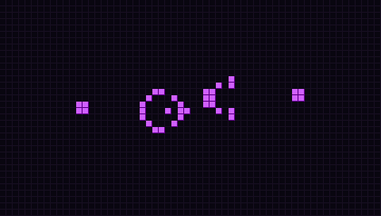

# sql-de-la-vie

Le **Jeu de la vie** de Conway, et toute sa famille de règles « B/S », écrit **entièrement en SQL**. Pas de boucle, pas de variable, pas de langage impératif : SQLite fait tout, de la lecture du motif jusqu'à la détection des cycles.



*Le canon à planeurs de Gosper, 240 générations calculées par une seule requête récursive.*

## Lancer

```sh
./vie.sh canon -l 60 -H 34 -g 240     # animation dans le terminal
./vie.sh --liste                      # les motifs fournis
./vie.sh diehard -b -g 140 -n         # juste le bilan
./vie.sh soupe -r B3678/S34678        # « Day & Night » sur une soupe aléatoire
./vie.sh -f motif.rle                 # n'importe quel motif de LifeWiki / Golly
./tests.sh                            # vérifie le moteur sur des résultats connus
```

Il faut `sqlite3` en version 3.44 ou plus. `vie.sh` ne calcule rien : il crée la table de paramètres, passe le script à `sqlite3`, et affiche les images une par une.

```
 ── bilan ──
 règle B3/S23 : une case naît avec 3 voisins, survit avec 2 ou 3
 grille 40×30 à bords morts, population 7 → 0 (max 40)
 tout est mort à la génération 130
 population ▂▂▃▃▅▄▅▆▄▄▄▅▄▅▃▃▄▅▆▆▇▅▅▇▅▇▆▅▃▃▃▂▃▄▃▅▅▆▅▇█▅▅▄▃▅▄▄▄▃▃▂▂▂▁▁▁▁▁▁
```

## Comment on fait ça en SQL

Tout est dans [`vie.sql`](vie.sql), commenté.

**La grille est une chaîne de caractères.** Une grille 40×24 devient un texte de 960 caractères, `#` pour une cellule vivante, `.` pour une morte. La case (x, y) est le caractère `y·w + x + 1`.

**Les voisins sont précalculés.** Une table `voisins(i, j)` liste les 8 voisins de chaque case, repliés sur un tore ou coupés aux bords (`-b`). On l'obtient en croisant la grille avec deux mini-tables `{-1, 0, 1}`.

**Chaque génération est une ligne d'une requête récursive.** Le cœur du programme :

```sql
WITH RECURSIVE g(n, s) AS (
  SELECT 0, (SELECT etat FROM depart)
  UNION ALL
  SELECT g.n + 1,
         (SELECT group_concat(
                   CASE WHEN instr(
                          CASE WHEN substr(g.s, c.i + 1, 1) = '#' THEN r.survie ELSE r.naissance END,
                          (SELECT sum(substr(g.s, v.j + 1, 1) = '#') FROM voisins v WHERE v.i = c.i)
                        ) > 0
                        THEN '#' ELSE '.' END,
                   '' ORDER BY c.i)
          FROM cases c, regle r)
  FROM g, param p WHERE g.n < p.gens
)
```

Pour chaque case on compte les `#` parmi ses voisins, puis on regarde si ce nombre figure dans la liste des chiffres de naissance (`'3'`) ou de survie (`'23'`) : `instr('23', 3) > 0`. Changer de règle, c'est seulement changer ces deux chaînes.

SQLite interdit les agrégats (`group_concat`, `sum`) directement dans la partie récursive. L'astuce est de les cacher dans des **sous-requêtes corrélées** : elles sont autorisées et voient la génération précédente `g.s`.

**Le format RLE est lu par un automate en SQL.** Un motif comme `bo$2bo$3o!` (le planeur) est lu caractère par caractère par une autre requête récursive, qui garde la position courante, le nombre en cours de lecture et émet des « séries » de cellules vivantes. Les commentaires `#` et l'en-tête `x = 5, y = 5, rule = B36/S23` sont reconnus ; la règle de l'en-tête est utilisée si on n'en donne pas.

**Le bilan est une jointure.** Un cycle, c'est deux générations identiques : `generations a JOIN generations b ON a.s = b.s AND a.n < b.n`, et la première trouvée donne la période. La courbe de population est un `group_concat` des caractères `▁▂▃▄▅▆▇█`.

**L'animation passe par un séparateur inhabituel.** Chaque image est une seule ligne du résultat, avec ses retours à la ligne dedans. `sqlite3 -newline $'\x1e'` sépare les lignes du résultat par le caractère « séparateur d'enregistrement » au lieu de `\n`, et `read -d $'\x1e'` les relit une par une.

## Règles à essayer

| Règle | Nom | Comportement |
|---|---|---|
| `B3/S23` | Conway | le classique |
| `B36/S23` | HighLife | avec `replicateur` : un motif qui se copie |
| `B2/S` | Seeds | rien ne survit, tout explose |
| `B3678/S34678` | Day & Night | vivant et mort jouent des rôles symétriques |
| `B1357/S1357` | Replicator | tout motif finit par se recopier |
| `B3/S012345678` | Life without death | rien ne meurt, des « échelles » poussent |
